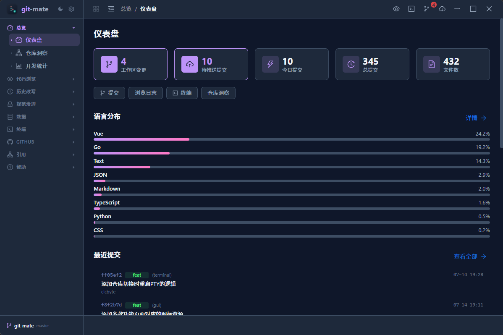
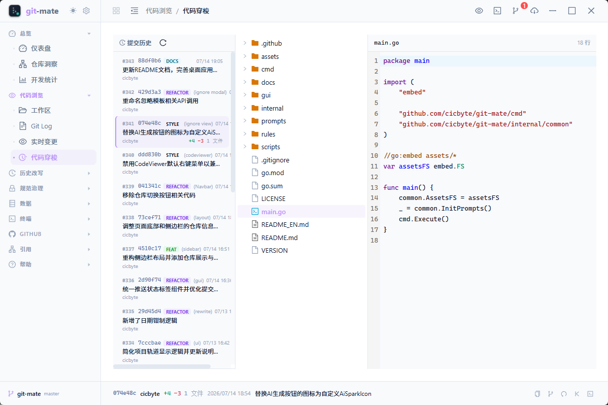
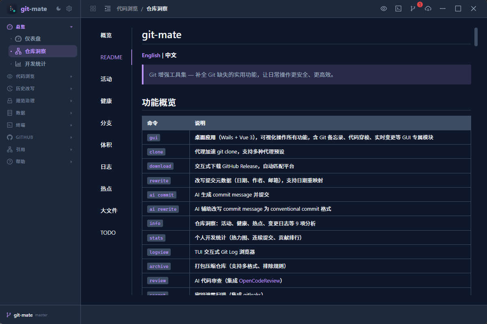
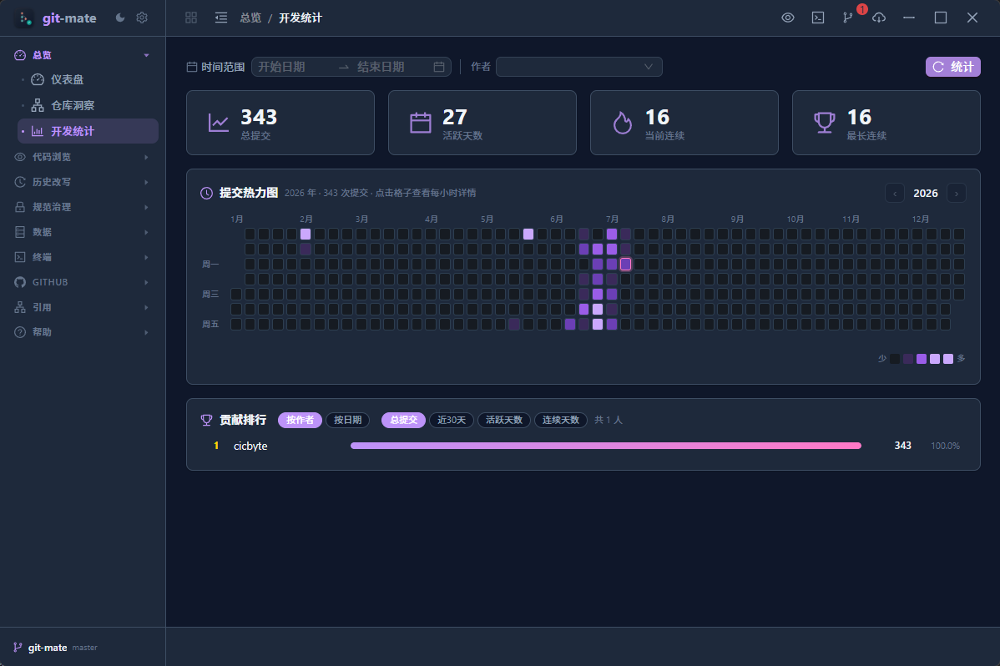
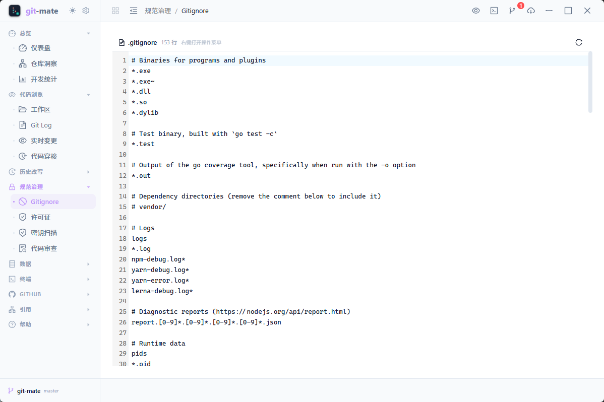
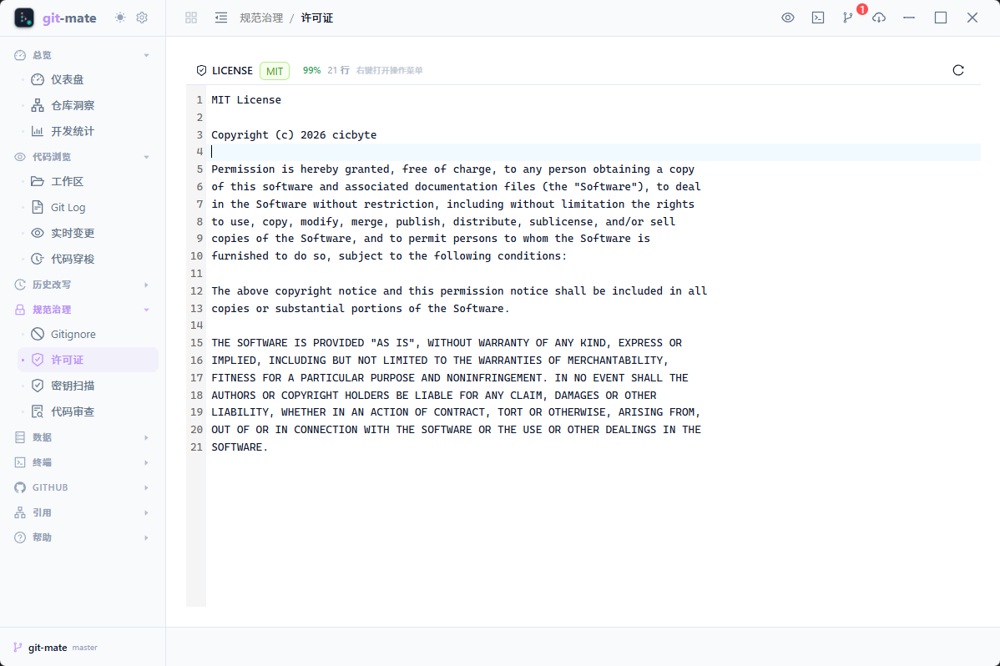
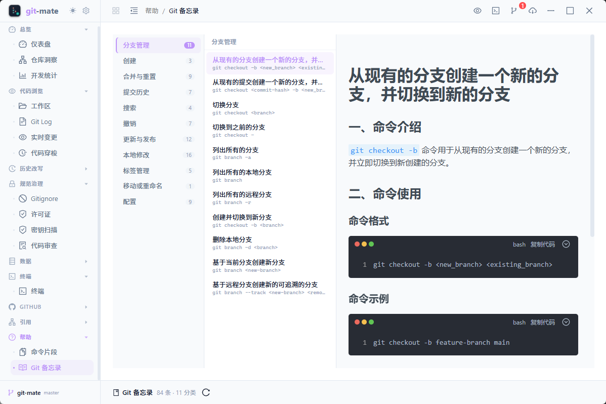

# byte-git GUI

**English | [中文](README.md)**

> The desktop app for byte-git — visualize every capability of the Git enhancement toolkit without memorizing commands.

Built with Wails v2 (Go backend) + Vue 3 (frontend), compiled into a single native binary — no Electron bloat.



## Screenshots

| | |
|---|---|
|  |  |
| **Git Log** — commit tree / diff / right-click actions | **Time Travel** — browse source at any commit |
|  |  |
| **Insights** — activity analysis / health check | **Dev Stats** — commit heatmap / rankings |
|  |  |
| **Gitignore** — AI tidy / template manager | **License** — create / detect / audit |
|  | |
| **Cheat Sheet** — three-pane command reference | |

## Features

- **Four-zone layout** — Project Rail + Sidebar + Topbar + Content; switch between repos with one click
- **Visual Git operations** — commit-tree browsing, side-by-side diff, right-click actions (cherry-pick / revert / reset / create branch)
- **Live change monitoring** — filesystem-level watching; topbar badge reflects working-tree changes in real time; drawer-style stage / commit / push
- **Embedded terminal** — PTY terminal (Windows ConPTY / Unix pty) with git-bash auto-detection; follows project switches
- **AI assistance** — AI-generated commit messages, AI history rewriting, AI code review (integrates OpenCodeReview)
- **Full GitHub integration** — PRs / Issues / Actions / Releases / Code Search / Trending without leaving the app
- **Reference repo browsing** — browse cited repositories (file tree / search / code preview), Wiki knowledge base
- **History rewriting** — visual commit-metadata editing, date remapping, AI batch rewriting with impact preview
- **Security governance** — full-history secret leak scanning (gitleaks), .gitignore management, open-source license management
- **Theming & responsive** — light / dark themes, auto-collapse sidebar on mobile

## Quick Start

### Prerequisites

- [Rust](https://rustup.rs/) >= 1.85 (MSVC toolchain / WebView2 on Windows)
- [Node.js](https://nodejs.org/) >= 20
- [Tauri CLI](https://tauri.app/) v2: `cargo install tauri-cli --version "^2"`
- Git >= 2.0

### Development

```bash
cd apps/desktop
npm --prefix frontend install   # Install frontend deps (first time)
cargo tauri dev                 # Start dev server with hot reload
```

### Build

```bash
cd apps/desktop
cargo tauri build               # Output to src-tauri/target/release/bundle/
```

The build produces a single native executable (`ByteGit.exe`); the frontend dist is embedded by Tauri.

## Tech Stack

| Layer | Technology |
|---|---|
| Desktop framework | [Tauri](https://tauri.app/) v2 — Rust backend + Webview frontend |
| Frontend framework | Vue 3.5 + TypeScript 5.7 |
| Build tool | Vite 6 |
| UI library | Ant Design Vue 4.2 |
| State management | Pinia 3 |
| Router | Vue Router 4 (hash mode) |
| Animation | GSAP 3 |
| Terminal | xterm.js 6 + addon-fit |
| Code editor | CodeMirror 6 (Go / JS / JSON / Markdown / Python / YAML) |
| Markdown | md-editor-v3 + marked |
| Backend language | Rust (domain logic in `crates/core`, command layer in `src-tauri`) |
| Bridge | `@tauri-apps/api` invoke + Wails-compatible adapter |

## Layout

```
┌──────────┬──────────────┬───────────────────────────────────┐
│ Project  │   Sidebar    │            Topbar                 │
│ Rail     │              │ Breadcrumb│Live│Term│SCM│DL│Window │
│          │ ▸ Overview   ├───────────────────────────────────┤
│ Repo A   │ ▸ Browse     │                                   │
│ Repo B   │ ▸ Rewrite    │                                   │
│ Repo C   │ ▸ Governance │         Content Area              │
│          │ ▸ Data       │                                   │
│ + Add    │ ▸ GitHub     │                                   │
│          │ ▸ ...        │                                   │
└──────────┴──────────────┴───────────────────────────────────┘
```

- **Project Rail** (leftmost): persistently lists recently opened repos; click to switch; colored avatars auto-generated from name hash
- **Sidebar**: 9 grouped categories (Overview / Browse / Rewrite / Governance / Data / Terminal / GitHub / Reference / Help); collapsible to icon-only mode
- **Topbar**: breadcrumb navigation, project-rail / sidebar toggles, quick entries, global SCM badge, Release download, window controls

## Modules

| Module | Description |
|---|---|
| **Dashboard** | Repo overview, today's commits / changes / push-ahead / file-count stat cards, language distribution, quick actions |
| **Workspace** | Read-only code browser (file tree + search + syntax-highlighted preview) |
| **Git Log** | Three-pane: commit tree / changed-file tree / side-by-side diff, hover preview, right-click actions |
| **Live Changes** | Filesystem watcher refreshes working-tree changes in real time; built-in stage / commit / push / AI message |
| **Time Travel** | Browse full source at any commit (git show): commit tree / file tree / code preview |
| **Terminal** | Embedded PTY terminal with git-bash auto-detection; auto-follows project switches |
| **Rewrite** | Visual commit-metadata editing (author / email / date / message), per-day distribution, rule batch |
| **AI Rewrite** | Task-driven rewriting: rule match → AI generate → review & approve → batch apply |
| **Data Editor** | Form / JSON dual-mode editing of rewrite data |
| **Code Review** | AI review of workspace / commit range / single commit, stepwise progress, diff suggestions |
| **Secret Scan** | Full-history secret leak scan (gitleaks), grouped by file, one-click scrub |
| **Gitignore** | AI tidy, local / GitHub templates, detection, template manager |
| **License** | Create, detect, dependency license audit |
| **Backup Manager** | Full clone backups, in-app file browser preview |
| **Git Manage** | Batch branch cleanup, stash management, rebase preview, safe undo |
| **Git Cheat Sheet** | Three-pane Git command reference (auto-clones content repo on first use) |
| **Snippets** | Personal Git command library (Ctrl+K global search + template variables + terminal integration) |
| **GitHub** | PR / Issues / Actions / Releases / Code Search / Trending full workflow |
| **Reference Repos** | Browse cited repositories, Wiki knowledge base, code stats |
| **Dev Stats** | Commit heatmap (per-day drill-down), streaks, contribution rankings |
| **Global SCM** | Topbar badge reflects change count in real time (global file watcher), drawer-style stage / commit / push |

## Project Structure

```
gui/
├── main.go                 # Wails app entry, window config (1200×800, frameless)
├── app.go                  # ByteGitApp instance, lifecycle, PTY / watcher
├── *.go                    # Go backend bindings (~46 files, ~280 Wails methods)
├── wails.json              # Wails build config
├── frontend/               # Vue 3 frontend
│   ├── src/
│   │   ├── views/          # 31 view pages
│   │   ├── components/     # 64 components (layout / common / info / settings ...)
│   │   ├── stores/         # Pinia stores (repo / scm / layout / theme / snippets ...)
│   │   ├── composables/    # Composition functions
│   │   ├── router/         # Router config (hash mode)
│   │   └── main.ts         # Frontend entry
│   ├── vite.config.ts      # Vite + Wails dev adapter
│   └── package.json
└── bin/                    # Build output
```

## Configuration

The GUI shares configuration with the CLI:

| Path | Content |
|---|---|
| `~/.cicbyte/apps/byte-git/config.yaml` | Global config (AI model, proxy, Token) |
| `~/.cicbyte/apps/byte-git/backups/` | Full repository backups |
| `~/.cicbyte/apps/byte-git/prompts/` | AI prompt templates |
| `~/.opencodereview/config.json` | Code-review LLM config (12 preset providers + custom gateways) |
| `.git/byte-git/` | Project-level data (hook config, rewrite JSON, AI cache) |

Feature toggles (Settings): enable GitHub, Reference, Secret Scan, Code Review on demand — disabled groups auto-hide from the sidebar.

## License

[MIT](../LICENSE) © 2025 cicbyte
